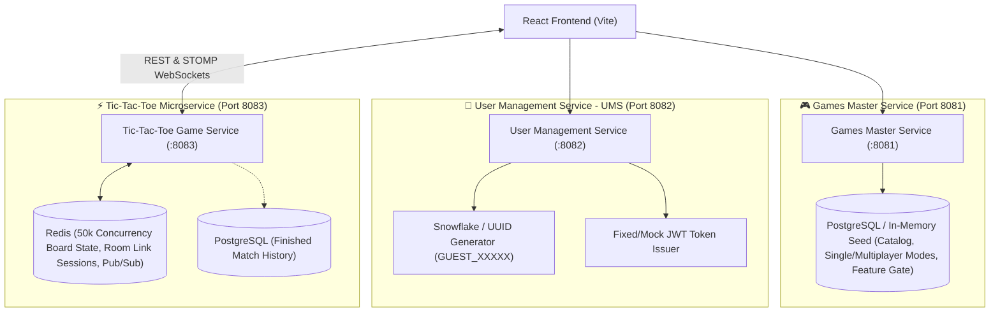

# 🏛️ Architecture & Microservice Decomposition: Platform Core & Games

> **Status:** Finalized Discussion Blueprint  
> **Scope:** 3 Distinct Core Services + 3 Dedicated PRDs

---

## 1. System Architecture Overview

---

## 2. Updated PRD Specifications

### 1. `product_prds/01-games-master-service-prd.md`
- **Single API for Dual-Mode UI**: `GET /api/v1/games/catalog` returns both mode card summaries (`SINGLE_PLAYER` vs `MULTIPLAYER`) and the complete game array.
- **Card-Filtered UI**: Users can toggle between the 🕹️ Single Player card and ⚔️ Multiplayer card to dynamically filter the linear scroll list.

### 2. `product_prds/02-user-management-service-prd.md`
- Auto-assigns `GUEST_<snowflakeId>` with persistent guest session token.
- Simple login form with mock credential verification issuing a fixed token (`owg-fixed-auth-token-2026`).

### 3. `product_prds/03-tic-tac-toe-game-prd.md`
- **Room Creation & Shareable Link**:
  - `POST /api/v1/tictactoe/rooms/create` -> returns `roomCode: "TTT-7X9B"` and shareable URL (`/games/tictactoe?room=TTT-7X9B`).
  - Host gets assigned `Player X`, waiting in room state (`WAITING_FOR_OPPONENT`).
  - Visiting player opens link or enters code -> auto-joins as `Player O` and triggers `ROOM_READY` via STOMP WebSocket.
- **50k Concurrency Scale**: Stateless Spring Boot instances backed by Redis state and Pub/Sub.
