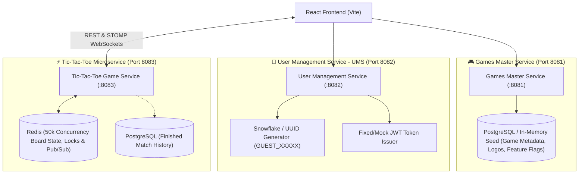

# 🏛️ Architecture & Microservice Decomposition: Platform Core & Games

> **Status:** Finalized Discussion Blueprint  
> **Scope:** 3 Distinct Core Services + 3 Dedicated PRDs

---

## 1. System Architecture Overview

---

## 2. Microservice Breakdown & PRD Mapping

### PRD 1: `games-master-service` (Port 8081)
- **Primary Responsibility:** Catalog, Metadata & Feature Gatekeeper.
- **Key Capabilities:**
  - Serves dynamic game list with titles, tags, thumbnails, logos, player limits (`MIN: 2`, `MAX: 2`), orientation, and launch routes.
  - **Feature Gate Switch:** Enables/disables games dynamically (`isActive: true/false`, `maintenanceMode: true/false`) without redeploying frontend.
  - Category and ordering control for the linear scrollable game list.

### PRD 2: `user-management-service` (Port 8082)
- **Primary Responsibility:** Lightweight Player Identity & Session Provider.
- **Key Capabilities:**
  - **Guest Auto-Provisioning:** Instantly generates a unique `GUEST_<snowflakeId>` (e.g. `GUEST_892374182`) with a persistent guest token for users entering the site.
  - **Mock / Quick Login:** Simple login form accepting any username & password, granting an authenticated player identity with fixed mock token (`fixed-auth-token-xyz`).
  - **Player Profile Snapshot:** Returns player avatar/name to display in the header and attaches to matchmaking queues.

### PRD 3: `tic-tac-toe-service` (Port 8083)
- **Primary Responsibility:** Real-time 2-Player Game Engine & Matchmaking.
- **Key Capabilities:**
  - Handles 2-player matchmaking queue (quick pairing or room code invitation).
  - Real-time turn-based gameplay over STOMP WebSockets.
  - Scalable for 50,000+ concurrent players using stateless Spring Boot + Redis session state.
  - Atomic move validation, win/draw detection, and game conclusion recording.
